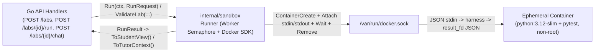

# Code Runner & Sandbox Design Specification

> **Status:** Finalized design specification (pre-implementation)  
> **Repository:** https://github.com/kradmoned/seekhein  
> **Go Module:** `github.com/kradmoned/seekhein`  
> **Branch:** `feat/code-runner`  
> **Scope:** Go `internal/sandbox` package, containerized Python test harness, and Docker hardening contract  
> **Boundary:** Browser → Go API (`internal/sandbox`) → Docker Engine → Ephemeral Python Sandbox Container

---

## 1. Scope & Integration Boundary

The code runner is built as a **clean, self-contained internal Go package (`internal/sandbox`)** inside the main Go backend rather than forking `sounishnath003/code-execution-sandbox-engine-golang`. We adopt Docker container hardening patterns (no network, CPU/memory/PID caps, non-root user, read-only rootfs, forced teardown) while avoiding multi-language `stdin`/`stdout` boilerplate that does not fit Python unit-test labs.



### Responsibilities

| Caller / Flow | Method Called | What `internal/sandbox` Returns |
|---|---|---|
| **Student Run** (`POST /api/labs/{id}/run`) | `Runner.Run(ctx, req)` → `result.ToStudentView()` | Safe `StudentRunResult`: status, score (`0..100`), `ran` / `total` / `passed` / `failed` counts, ordered per-test breakdown (`{index, name, display_name, hidden, status, passed, inputs, expected, actual, error_type, error_message, traceback, stdout}` — with `inputs`/`expected`/`actual`/assertion `error_message` omitted on `test_hidden_*`), top-level `stdout`, and `solution.py` syntax-error line only |
| **AI Tutor** (`POST /api/labs/{id}/chat`) | `result.ToTutorContext()` (or persisted context from latest run) | `TutorRunContext`: overall progress (`score`, `ran`/`total`), `passed_tests`, **all** failing/timed-out tests with full `inputs`/`expected`/`actual`, per-test `stdout`, `solution.py` `traceback`, and internal `detail` (including for `test_hidden_*` tests — server-side only, passed to Python AI service + leak guard) |
| **Teacher Lab Upload** (`POST /api/labs`) | `Runner.ValidateLab(ctx, solutionCode, testCode)` | Rich `ValidationResult`: enforces `total >= 1` and 100% pass rate; returns syntax-error `source` (`"solution"` vs `"tests"`), full per-test diagnostics (including `<hidden_test>` tracebacks), standard vs. hidden test counts, and pedagogical authoring `Warnings` |
| **Standalone Local Testing (Optional)** | `cmd/runner` thin HTTP/CLI wrapper | Exposes `POST /run` locally so the runner can be tested independently while other backend handlers are under development |

---

## 2. Language & Test Format

- **Language:** Python 3.12 only (hackathon scope).
- **Module Contract:** Student code is written inside the container as `/work/solution.py`. Teacher-authored tests import student symbols using standard Python imports:
  - `from solution import two_sum, ...`
  - `import solution`
- **Supported Test Styles:**
  1. Top-level `def test_*():` functions using plain `assert` statements or the harness-injected `expect(actual, expected, inputs=...)` helper.
  2. `pytest.raises(...)` and `pytest.approx(...)` helpers (via `pytest` installed in the image).
  3. `unittest.TestCase` subclasses (`test_*` methods, e.g., `assertEqual`).
- **Boot.dev 2-Tier Visibility Convention (Learning vs. Anti-Hardcoding):**
  - **Standard learning tests (`def test_*`, not prefixed `test_hidden_`):** Surface full Boot.dev-style diagnostics to the student (`inputs`, `expected`, `actual`, `error_message`, filtered `solution.py`-only `traceback`, and per-test `stdout`) so students clearly see what went wrong and why.
  - **Hidden anti-hardcoding tests (`def test_hidden_*`):** Marked `hidden: true`. `ToStudentView()` strips `inputs`, `expected`, `actual`, and assertion `error_message`, returning only the safe `display_name`, pass/fail/timeout `status`, `error_type`, any crashing `solution.py` traceback line, and the student's own per-test `stdout`. Raw test source and reference solutions **never** leave the server.
- **Optional `expect(actual, expected, inputs=None)` Helper:**
  - The harness injects a lightweight `expect(actual, expected, inputs=None)` function into the test namespace so teachers can effortlessly record structured `Inputs`, `Expecting`, and `Actual` values (even on passing tests, Boot.dev style), raising `AssertionError` on mismatch.
  - Standard `assert expr, "msg"` and `unittest` `assertEqual` continue to work out of the box and automatically populate `error_message`.
- **Test Discovery, Naming & Execution Rules:**
  - Top-level callables whose name starts with `test_` (executed in definition order).
  - `unittest.TestCase` subclasses and their `test_*` methods (running `setUp`/`tearDown` per method if defined).
  - **Continue-on-failure (never fail-fast):** On every submission, the harness executes **all** discovered tests independently—even after an assertion failure, unhandled exception, or per-test `SIGALRM` timeout—so the student always sees how many tests ran (`ran` vs. `total`) and the exact pass/fail breakdown for every test.
  - **Optional safe student-facing label (docstring convention):** Teachers may put a concise one-line docstring on a `def test_*()` function (e.g., `"""Handles an empty input list"""`), which the harness extracts into `display_name`. If omitted, `display_name` defaults to a humanized form of the function name (e.g., `test_empty_list` → `"Empty list"`).
  - Labs with **0 discovered tests** are rejected at teacher upload time by `ValidateLab`.

---

## 3. Python Sandbox Docker Image

A dedicated `Dockerfile` builds the sandbox image (e.g., `seekkhein-python-sandbox:latest`):

- **Base image:** `python:3.12-slim`
- **Installed dependencies:** Python stdlib + `pytest` (specifically for `pytest.raises`, `pytest.approx`, and assertion helpers; no heavy data-science packages)
- **Non-root user:** `sandbox` (`UID=1000`, `GID=1000`) baked into the image
- **Baked-in harness:** Read-only runner script (e.g., `/opt/sandbox/harness.py`, owned by `root:root`, mode `0555`) executed as container entrypoint (`python3 -I /opt/sandbox/harness.py` or `python3 -B /opt/sandbox/harness.py` with `PYTHONDONTWRITEBYTECODE=1`)
- **Fail-fast startup check:** `NewRunner(ctx, cfg)` pings the Docker daemon (`Ping`) and verifies the configured sandbox image exists locally (`ImageInspectWithRaw`), returning a clear, actionable error on startup if Docker is unreachable or the image has not been built.

---

## 4. Docker Communication & Payload Delivery

Go communicates directly with the Docker Engine via the **Official Docker Go SDK** (`github.com/docker/docker/client`, initialized with `client.FromEnv` and `client.WithAPIVersionNegotiation()`) over `/var/run/docker.sock`.

- **Zero host bind mounts and zero host temp files:** Nothing is written to the host filesystem.
- **JSON-over-stdin streaming:**
  1. `ContainerCreate` configures `OpenStdin: true`, `StdinOnce: true`, `AttachStdin: true`, `AttachStdout: true`, `AttachStderr: true`, `Tty: false`, plus all `HostConfig` security/resource limits.
  2. `ContainerAttach` opens the hijacked stream (`Stdin: true, Stdout: true, Stderr: true, Stream: true`).
  3. `ContainerStart` starts the container.
  4. Go writes the JSON payload (`{"code": "...", "tests": "...", "per_test_timeout_sec": 2}`) to `attach.Conn` and immediately calls `attach.CloseWrite()` so the Python harness receives `EOF` on `sys.stdin`.
  5. Go demuxes the multiplexed Docker stream via `stdcopy.StdCopy` into bounded buffers (`io.LimitWriter` / capped bytes buffer) so a misbehaving container cannot OOM the Go API process.
  6. Go awaits completion via `ContainerWait` bounded by the hard container timeout (`context.WithTimeout`).
  7. After exit or timeout, Go inspects the container (`ContainerInspect`) to check `State.OOMKilled` and `State.ExitCode`.
  8. `defer ContainerRemove(cleanupCtx, containerID, container.RemoveOptions{Force: true})` runs unconditionally (using a short independent cleanup context) so timed-out or failed containers are never leaked.

```mermaid
sequenceDiagram
    autonumber
    participant Go as Go Runner (internal/sandbox)
    participant Docker as Docker Engine (SDK)
    participant Py as Container Harness (UID 1000)

    Go->>Go: Validate input sizes (<= 64KB each)
    Go->>Go: Acquire worker semaphore (max 4, wait <= 10s)
    Go->>Docker: ContainerCreate (no net, ro rootfs, tmpfs /work, 128MB, 0.5 CPU, 64 PIDs)
    Go->>Docker: ContainerAttach (stdin/stdout/stderr)
    Go->>Docker: ContainerStart
    Go->>Py: Write JSON {code, tests, per_test_timeout_sec} + CloseWrite() (EOF)
    Py->>Py: Save result_fd = os.dup(1); write /work/solution.py
    Py->>Py: compile(tests, "<hidden_test>", "exec"); del test_src
    Py->>Py: Redirect FD 1 & FD 2 -> capped 16KB capture buffer
    loop Each discovered test (SIGALRM = 2s)
        Py->>Py: Run test & record {name, passed, error_type, detail}
    end
    Py->>Go: Write single JSON result to result_fd; exit 0
    Docker-->>Go: ContainerWait returns (or hard 6s ctx deadline expires)
    Go->>Docker: ContainerInspect (check OOMKilled / ExitCode)
    Go->>Docker: ContainerRemove(Force: true)
    Go->>Go: Release worker semaphore & parse result
```

---

## 5. Hidden-Test Isolation & Output Capture

### In-Container Harness Lifecycle

1. **Read & close stdin:** Read the JSON payload from `sys.stdin` and immediately close stdin.
2. **Reserve output channel:** Duplicate the original stdout descriptor (`result_fd = os.dup(1)`) so the harness retains an exclusive channel back to Go that student code cannot accidentally corrupt.
3. **Materialize student code only:** Write `code` to `/work/solution.py` inside the ephemeral `tmpfs` mount (`/work`), and add `/work` to `sys.path`.
4. **In-memory test compilation (never on disk):** Compile `tests` in memory using `compile(test_src, "<hidden_test>", "exec")` into a code object, then immediately run `del test_src` and `del payload` before importing `solution.py`. **No `test_lab.py` file ever exists on disk.**
5. **Redirect FD 1 & FD 2 for per-test & import stdout capture:**
   - Replace OS file descriptors `1` and `2` (via `os.dup2` into a pipe/memfd/tmp buffer or capped reader) and Python `sys.stdout` / `sys.stderr` so both Python `print()` and native/C-level writes are captured **per test** (reset/snapshotted around each test, capped at **4KB per test** and **16KB total** across the run, setting `stdout_truncated = true` if exceeded). Top-level prints during `import solution` are stored in `RunResult.Stdout`.
   - Because `result_fd` is a separate duped descriptor and is only written after test execution completes (while `sys.stdout` / FD 1 remain isolated during student execution), student `print('{"status":"ok",...}')` statements **cannot forge or corrupt** the JSON result read by Go.
6. **Compile tests, import & execute under per-test timeout:**
   - First compile `tests` (`<hidden_test>`):
     - On `SyntaxError` or `IndentationError` in `<hidden_test>`: record `status = "syntax_error"`, internal `source = "tests"`, `error_type`, `error_message`, `line`, and offending `code_line` so teacher lab upload gets exact test-file diagnostics (while `ToStudentView()` strips `tests`-sourced syntax location if ever encountered).
   - Next validate/import `solution` (`/work/solution.py`):
     - On `SyntaxError` or `IndentationError` originating in `solution.py`: record `status = "syntax_error"`, internal `source = "solution"`, `error_type`, `error_message`, `line`, and offending `code_line` (only `error_type`, `error_message`, `line`, and `code_line` from `solution.py` are exposed to `StudentRunResult`).
     - On import-time runtime exception (e.g., `ImportError`, `NameError`, `ZeroDivisionError`): record `status = "runtime_error"`, `error_type = type(e).__name__`, `error_message`, filtered `solution.py` traceback frames, and full raw traceback in `internal_error` (for `ToTutorContext()` and `ValidateLab()`), and exit cleanly.
   - **Continue-on-failure loop:** Iterate through **all** discovered tests in order (never stopping on the first failure), running each under `signal.setitimer(signal.ITIMER_REAL, per_test_timeout_sec)` / `signal.SIGALRM` and resetting the timer in a `finally` block:
     - Determine `hidden = fn.__name__.startswith("test_hidden_")` and extract `display_name` from the first line of `fn.__doc__` (trimmed, capped to 120 chars) or fall back to humanizing `fn.__name__`.
     - Inject/reset per-test `expect(...)` recorder state so any structured `inputs`, `expected`, and `actual` values from the test are captured on both pass and failure.
     - **Filtered `solution.py` traceback extraction:** On exception, extract stack frames via `traceback.extract_tb(e.__traceback__)` and retain **only** frames where `frame.filename == "/work/solution.py"` (`{line, function, code}`), stripping all `<hidden_test>` and harness frames from `traceback` so hidden test source never leaks to `StudentRunResult`.
     - **Full internal `detail` retention:** Also capture the full formatted traceback (including `<hidden_test>` assertion line and exception args, capped e.g. 2KB) in `detail`. This field is strictly server-side (`json:"-"` on `TestResult`) and is exposed only via `ToTutorContext()` and `ValidateLab()`.
     - Pass → `status = "passed"`, `passed = true`, `ran` incremented (includes `inputs`/`expected`/`actual` if recorded via `expect(...)`, and per-test `stdout`).
     - Exception → `status = "failed"`, `passed = false`, `error_type = type(e).__name__`, `error_message = str(e)` (capped, e.g., 512 chars), filtered `solution.py` `traceback`, per-test `stdout`, `ran` incremented, plus full `detail`. For `hidden == true`, `ToStudentView()` strips `inputs`, `expected`, `actual`, and assertion `error_message` (while `ToTutorContext()` keeps all of them).
     - Timeout (`SIGALRM` handler raises internal timeout exception) → `status = "timeout"`, `passed = false`, `error_type = "TimeoutError"`, `error_message = "Test exceeded 2s time limit"`, per-test `stdout`, `ran` incremented, and subsequent tests continue running until the hard container deadline.
7. **Sanitize & emit JSON:** Restore/flush captured stdout (truncated safely to UTF-8 boundaries), write the single JSON object to `result_fd`, flush, close `result_fd`, and exit `0`.

### Threat Model Honesty (Hackathon Scope vs. Post-Hackathon)

- **Mitigated now:**
  - Disk exfiltration of hidden tests (`open("test_lab.py")`, `os.listdir`, `cat` via subprocess): `test_lab.py` is never written to disk and `test_src` string is deleted before student code runs.
  - Network exfiltration (`requests`, `urllib`, `socket`): blocked by `NetworkMode: "none"`.
  - Host filesystem tampering / container escape: blocked by read-only rootfs, `CapDrop: ["ALL"]`, `no-new-privileges:true`, non-root UID 1000, and zero bind mounts.
  - Output stream / JSON injection: student stdout/stderr are redirected away from `result_fd` and size-capped at 16KB.
  - Fork bombs / memory bombs / infinite loops: blocked by `PidsLimit: 64`, `128MB` RAM with swap off, `0.5` vCPU, `2s` per-test `SIGALRM`, and `6s` hard container removal.
- **Acknowledged out-of-scope for hackathon:**
  - Because tests and student code execute in the same Python interpreter process, adversarial introspection of Python runtime objects (`gc.get_objects()`, `sys._getframe()`, `inspect.getsource` on frame/code objects, or modifying `signal.SIGALRM`) is theoretically possible in-process.
  - **Post-hackathon upgrade path:** Run student code in a separate unprivileged worker subprocess communicating over a narrow RPC pipe (or run tests in an isolated parent process while student code runs in a child process / gVisor / Firecracker microVM).

---

## 6. Resource Limits, Hardening & Concurrency

### Docker `HostConfig` & Container Security Settings

| Setting | Value | Purpose |
|---|---|---|
| `NetworkMode` | `"none"` | Disables all network interfaces (only loopback exists; no egress) |
| `Memory` | `128 * 1024 * 1024` (128 MiB) | Hard RAM cap |
| `MemorySwap` | `128 * 1024 * 1024` (equal to `Memory`) | Disables swap completely |
| `NanoCPUs` | `500_000_000` (0.5 vCPU) | Prevents CPU starvation of host / other containers |
| `PidsLimit` | `64` | Blocks fork bombs and thread/process floods |
| `ReadonlyRootfs` | `true` | Prevents modifying system binaries, harness, or Python stdlib |
| `Tmpfs` | `{"/work": "rw,noexec,nosuid,size=8m"}` | Ephemeral writable scratch space for `solution.py` only |
| `CapDrop` | `["ALL"]` | Drops all Linux capabilities |
| `SecurityOpt` | `["no-new-privileges:true"]` | Blocks privilege escalation via setuid/file caps |
| `User` | `"1000:1000"` | Non-root `sandbox` user |
| `AutoRemove` | `false` (explicit `defer ContainerRemove Force: true`) | Ensures `ContainerInspect` can read `OOMKilled` before removal |

### Timeouts, Size Caps & Concurrency Controls

| Limit | Default | Enforcement Point |
|---|---|---|
| Max student `code` size | `64 KB` | Go `Runner.Run` before acquiring semaphore (`ErrCodeTooLarge`) |
| Max hidden `tests` size | `64 KB` | Go `Runner.Run` before acquiring semaphore (`ErrTestsTooLarge`) |
| Max concurrent containers | `4` (configurable) | Go bounded worker semaphore (`chan struct{}`) |
| Semaphore queue wait timeout | `10s` (configurable) | Go `select` on semaphore vs. timer/ctx (`ErrQueueFull`) |
| Per-test execution timeout | `2s` (configurable) | Python `SIGALRM` timer inside container |
| Hard container timeout | `6s` (configurable) | Go `context.WithTimeout` around start/wait + `ContainerRemove(Force: true)` |
| Max captured student stdout | `16 KB` | Python capture buffer + Go `stdcopy` bounded writer (`StdoutTruncated: true`) |

---

## 7. Go Interface Contract & Leak-Safe Views

Package: `internal/sandbox`

```go
package sandbox

import (
	"context"
	"errors"
	"time"
)

var (
	ErrCodeTooLarge       = errors.New("sandbox: code exceeds maximum size")
	ErrTestsTooLarge      = errors.New("sandbox: tests exceed maximum size")
	ErrQueueFull          = errors.New("sandbox: worker queue saturated")
	ErrSandboxUnavailable = errors.New("sandbox: docker daemon or image unavailable")
)

type Config struct {
	Image              string        // default: "seekkhein-python-sandbox:latest"
	MaxConcurrent      int           // default: 4
	QueueWaitTimeout   time.Duration // default: 10 * time.Second
	PerTestTimeout     time.Duration // default: 2 * time.Second
	ContainerTimeout   time.Duration // default: 6 * time.Second
	MaxCodeBytes       int           // default: 64 * 1024
	MaxTestsBytes      int           // default: 64 * 1024
	MaxStdoutBytes     int           // default: 16 * 1024
	MemoryLimitBytes   int64         // default: 128 * 1024 * 1024
	NanoCPUs           int64         // default: 500_000_000
	PidsLimit          int64         // default: 64
}

type Runner interface {
	Run(ctx context.Context, req RunRequest) (*RunResult, error)
	ValidateLab(ctx context.Context, solutionCode, testCode string) (*ValidationResult, error)
	Close() error
}

// NewRunner creates a Docker-backed Runner and fails fast if Docker Ping
// or sandbox image inspection fails.
func NewRunner(ctx context.Context, cfg Config) (Runner, error)

type RunRequest struct {
	Code           string
	Tests          string
	PerTestTimeout time.Duration // optional override; 0 uses Config.PerTestTimeout
}

type RunStatus string

const (
	StatusOK           RunStatus = "ok"
	StatusSyntaxError  RunStatus = "syntax_error"
	StatusRuntimeError RunStatus = "runtime_error"
	StatusTimeout      RunStatus = "timeout"
	StatusOOM          RunStatus = "oom"
	StatusInternalErr  RunStatus = "internal_error"
)

type SyntaxErrorInfo struct {
	Source       string `json:"-"`                       // internal-only: "solution" or "tests"
	ErrorType    string `json:"error_type"`              // e.g. "SyntaxError", "IndentationError"
	ErrorMessage string `json:"error_message,omitempty"` // e.g. "expected ':'"
	Line         int    `json:"line"`                    // 1-based line number in solution.py (0 if not from solution.py)
	CodeLine     string `json:"code_line,omitempty"`     // offending line text from solution.py
}

type TraceFrame struct {
	Line     int    `json:"line"`
	Function string `json:"function"`
	Code     string `json:"code"`
}

type TestStatus string

const (
	TestPassed   TestStatus = "passed"
	TestFailed   TestStatus = "failed"
	TestTimedOut TestStatus = "timeout"
	TestNotRun   TestStatus = "not_run"
)

type TestResult struct {
	Index           int          `json:"index"`        // 1-based test order
	Name            string       `json:"name"`         // raw function/method name (e.g. "test_empty_list")
	DisplayName     string       `json:"display_name"` // docstring first line or humanized Name
	Hidden          bool         `json:"hidden"`       // true when Name starts with "test_hidden_"
	Status          TestStatus   `json:"status"`       // "passed", "failed", "timeout", "not_run"
	Passed          bool         `json:"passed"`
	Inputs          string       `json:"inputs,omitempty"`
	Expected        string       `json:"expected,omitempty"`
	Actual          string       `json:"actual,omitempty"`
	ErrorType       string       `json:"error_type,omitempty"`
	ErrorMessage    string       `json:"error_message,omitempty"`
	Traceback       []TraceFrame `json:"traceback,omitempty"` // strictly solution.py frames only
	Stdout          string       `json:"stdout,omitempty"`
	StdoutTruncated bool         `json:"stdout_truncated,omitempty"`
	DurationMs      int64        `json:"duration_ms"`
	Detail          string       `json:"-"` // internal-only raw traceback/assertion snippet; never serialized to student
}

type RunResult struct {
	Status          RunStatus        `json:"status"`
	Score           int              `json:"score"`  // 0..100 integer percentage
	Ran             int              `json:"ran"`    // number of tests actually executed
	Passed          int              `json:"passed"` // number of tests that passed
	Failed          int              `json:"failed"` // number of tests that ran and failed/timed out
	Total           int              `json:"total"`  // total discovered tests in the lab
	Stdout          string           `json:"stdout"` // top-level import stdout (if any)
	StdoutTruncated bool             `json:"stdout_truncated"`
	DurationMs      int64            `json:"duration_ms"`
	Tests           []TestResult     `json:"tests"`
	SyntaxError     *SyntaxErrorInfo `json:"syntax_error,omitempty"`
	InternalError   string           `json:"-"` // never exposed to student
}
```

### Leak-Safe Views & Helper Methods

1. **`(*RunResult).ToStudentView() StudentRunResult`** — Returns a dedicated browser-safe struct. For standard tests, it preserves full Boot.dev learning diagnostics (`Inputs`, `Expected`, `Actual`, `ErrorMessage`, `solution.py`-only `Traceback`, and per-test `Stdout`). When `test.Hidden == true` (`test_hidden_*`), `ToStudentView()` explicitly strips `Inputs`, `Expected`, `Actual`, and assertion `ErrorMessage`, and `Detail` is always omitted on every test:

```go
type StudentTestResult struct {
	Index           int          `json:"index"`
	Name            string       `json:"name"`
	DisplayName     string       `json:"display_name"`
	Hidden          bool         `json:"hidden"`
	Status          TestStatus   `json:"status"`
	Passed          bool         `json:"passed"`
	Inputs          string       `json:"inputs,omitempty"`
	Expected        string       `json:"expected,omitempty"`
	Actual          string       `json:"actual,omitempty"`
	ErrorType       string       `json:"error_type,omitempty"`
	ErrorMessage    string       `json:"error_message,omitempty"`
	Traceback       []TraceFrame `json:"traceback,omitempty"`
	Stdout          string       `json:"stdout,omitempty"`
	StdoutTruncated bool         `json:"stdout_truncated,omitempty"`
	DurationMs      int64        `json:"duration_ms"`
}

type StudentRunResult struct {
	Status          RunStatus           `json:"status"`
	Score           int                 `json:"score"`
	Ran             int                 `json:"ran"`
	Passed          int                 `json:"passed"`
	Failed          int                 `json:"failed"`
	Total           int                 `json:"total"`
	Stdout          string              `json:"stdout"`
	StdoutTruncated bool                `json:"stdout_truncated"`
	DurationMs      int64               `json:"duration_ms"`
	Tests           []StudentTestResult `json:"tests"`
	SyntaxError     *SyntaxErrorInfo    `json:"syntax_error,omitempty"`
}
```

#### Example `StudentRunResult` JSON Payload (5-Test Submission: 2 Passed, 3 Failed)

```json
{
  "status": "ok",
  "score": 40,
  "ran": 5,
  "passed": 2,
  "failed": 3,
  "total": 5,
  "stdout": "",
  "stdout_truncated": false,
  "duration_ms": 148,
  "tests": [
    {
      "index": 1,
      "name": "test_basic_pair",
      "display_name": "Finds matching pair in basic list",
      "hidden": false,
      "status": "passed",
      "passed": true,
      "inputs": "nums=[2, 7, 11, 15], target=9",
      "expected": "[0, 1]",
      "actual": "[0, 1]",
      "duration_ms": 1
    },
    {
      "index": 2,
      "name": "test_negative_numbers",
      "display_name": "Handles negative integers",
      "hidden": false,
      "status": "passed",
      "passed": true,
      "inputs": "nums=[-3, 4, 3, 90], target=0",
      "expected": "[0, 2]",
      "actual": "[0, 2]",
      "duration_ms": 1
    },
    {
      "index": 3,
      "name": "test_empty_list",
      "display_name": "Returns empty list on empty input",
      "hidden": false,
      "status": "failed",
      "passed": false,
      "inputs": "nums=[], target=5",
      "error_type": "IndexError",
      "error_message": "list index out of range",
      "traceback": [
        {
          "line": 3,
          "function": "two_sum",
          "code": "first = nums[0]"
        }
      ],
      "stdout": "checking nums=[]\n",
      "duration_ms": 2
    },
    {
      "index": 4,
      "name": "test_duplicate_elements",
      "display_name": "Does not reuse the same index twice",
      "hidden": false,
      "status": "failed",
      "passed": false,
      "inputs": "nums=[3, 3], target=6",
      "expected": "[0, 1]",
      "actual": "[0, 0]",
      "error_type": "AssertionError",
      "error_message": "expected [0, 1], got [0, 0]",
      "duration_ms": 1
    },
    {
      "index": 5,
      "name": "test_hidden_large_case",
      "display_name": "Handles hidden edge cases",
      "hidden": true,
      "status": "failed",
      "passed": false,
      "error_type": "AssertionError",
      "duration_ms": 14
    }
  ]
}
```

#### Boot.dev-Style Rendered Student Output (from `StudentRunResult`)

```text
Running 5 tests...
---------------------------------
Test 1/5: Finds matching pair in basic list
Inputs:    nums=[2, 7, 11, 15], target=9
Expecting: [0, 1]
Actual:    [0, 1]
Result:    Pass (1ms)
---------------------------------
Test 2/5: Handles negative integers
Inputs:    nums=[-3, 4, 3, 90], target=0
Expecting: [0, 2]
Actual:    [0, 2]
Result:    Pass (1ms)
---------------------------------
Test 3/5: Returns empty list on empty input
Inputs:    nums=[], target=5
Stdout:    checking nums=[]
Error:     IndexError: list index out of range
Traceback (solution.py):
  line 3, in two_sum: first = nums[0]
Result:    Fail (2ms)
---------------------------------
Test 4/5: Does not reuse the same index twice
Inputs:    nums=[3, 3], target=6
Expecting: [0, 1]
Actual:    [0, 0]
Result:    Fail (1ms)
---------------------------------
Test 5/5 (Hidden): Handles hidden edge cases
Error:     AssertionError
Result:    Fail (14ms)
=================================
FAIL — 2 passed, 3 failed (5/5 tests ran) · Score: 40%
```

2. **`(*RunResult).ToTutorContext() TutorRunContext`** — Server-side rich summary passed to the Python AI tutor service (Step 6). Unlike `ToStudentView()`, it gives the tutor the **complete pedagogical picture**: what the student already passed (`PassedTests`), **every** failing or timed-out test (including `test_hidden_*` internal `Inputs`, `Expected`, `Actual`, and full `Detail`), the student's debug `Stdout` per test, and exact `solution.py` `Traceback` lines. The Python AI tutor uses this to give targeted Socratic hints (e.g., spotting an off-by-one or empty-list bug without giving away the answer), while its leak guard prevents quoting the reference solution or hidden test values directly:

```go
type TutorSyntaxError struct {
	Source       string `json:"source"` // "solution" or "tests"
	ErrorType    string `json:"error_type"`
	ErrorMessage string `json:"error_message,omitempty"`
	Line         int    `json:"line"`
	CodeLine     string `json:"code_line,omitempty"`
}

type TutorTestFailure struct {
	Index        int          `json:"index"`
	Name         string       `json:"name"`
	DisplayName  string       `json:"display_name"`
	Hidden       bool         `json:"hidden"`
	Status       TestStatus   `json:"status"` // "failed" or "timeout"
	Inputs       string       `json:"inputs,omitempty"`
	Expected     string       `json:"expected,omitempty"`
	Actual       string       `json:"actual,omitempty"`
	ErrorType    string       `json:"error_type,omitempty"`
	ErrorMessage string       `json:"error_message,omitempty"`
	Traceback    []TraceFrame `json:"traceback,omitempty"` // solution.py frames
	Stdout       string       `json:"stdout,omitempty"`
	Detail       string       `json:"detail,omitempty"` // full internal traceback including hidden assertion line
	DurationMs   int64        `json:"duration_ms"`
}

type TutorRunContext struct {
	Status         RunStatus          `json:"status"`
	Score          int                `json:"score"`
	Ran            int                `json:"ran"`
	Passed         int                `json:"passed"`
	Failed         int                `json:"failed"`
	Total          int                `json:"total"`
	DurationMs     int64              `json:"duration_ms"`
	PassedTests    []string           `json:"passed_tests"`              // names/labels of tests already passing
	Failures       []TutorTestFailure `json:"failures"`                  // ALL failing/timed-out tests with full detail
	SyntaxError    *TutorSyntaxError  `json:"syntax_error,omitempty"`
	TopLevelStdout string             `json:"top_level_stdout,omitempty"`
	InternalError  string             `json:"internal_error,omitempty"`
}
```

3. **`Runner.ValidateLab(ctx, solutionCode, testCode) (*ValidationResult, error)`** — Used in Step 3 when a teacher uploads a `.md` lab. Runs the teacher's reference solution against the lab's test suite and returns rich diagnostics so the teacher can fix broken tests/solutions and improve student-facing feedback:
   - **Blocking validation gates:** Rejects labs (`Valid = false`) if `Status != StatusOK`, `TotalTests < 1` (0-test labs are invalid), or `PassedTests != TotalTests`.
   - **Full teacher diagnostics:** Includes syntax-error `Source` (`"solution"` vs. `"tests"`), full unredacted `<hidden_test>` + `solution.py` tracebacks (`FullTraceback`), `Inputs`/`Expected`/`Actual`, and standard vs. hidden test counts.
   - **Non-blocking pedagogical `Warnings`:** Helps teachers author higher-quality labs for students:
     1. *Slow reference test:* warns if any test takes `> 50%` of `PerTestTimeout` (risks flaky timeouts for students).
     2. *No visible feedback:* warns if all tests are `test_hidden_*` (students will not see any `Inputs` / `Expecting` / `Actual` diffs).
     3. *Missing Boot.dev labels/expectations:* warns if standard `def test_*` functions lack both a docstring `display_name` and an `expect(...)` call.

```go
type TeacherSyntaxError struct {
	Source       string `json:"source"` // "solution" or "tests"
	ErrorType    string `json:"error_type"`
	ErrorMessage string `json:"error_message"`
	Line         int    `json:"line"`
	CodeLine     string `json:"code_line,omitempty"`
}

type TeacherTestDiagnostic struct {
	Index         int        `json:"index"`
	Name          string     `json:"name"`
	DisplayName   string     `json:"display_name"`
	Hidden        bool       `json:"hidden"`
	Status        TestStatus `json:"status"`
	Passed        bool       `json:"passed"`
	Inputs        string     `json:"inputs,omitempty"`
	Expected      string     `json:"expected,omitempty"`
	Actual        string     `json:"actual,omitempty"`
	ErrorType     string     `json:"error_type,omitempty"`
	ErrorMessage  string     `json:"error_message,omitempty"`
	FullTraceback string     `json:"full_traceback,omitempty"` // includes both <hidden_test> and solution.py frames
	Stdout        string     `json:"stdout,omitempty"`
	DurationMs    int64      `json:"duration_ms"`
}

type ValidationResult struct {
	Valid         bool                    `json:"valid"`
	Summary       string                  `json:"summary"` // human-readable reason (e.g. "2 of 5 tests failed against reference solution")
	Status        RunStatus               `json:"status"`
	DurationMs    int64                   `json:"duration_ms"`
	TotalTests    int                     `json:"total_tests"`
	RanTests      int                     `json:"ran_tests"`
	PassedTests   int                     `json:"passed_tests"`
	FailedTests   int                     `json:"failed_tests"`
	StandardTests int                     `json:"standard_tests"`
	HiddenTests   int                     `json:"hidden_tests"`
	SyntaxError   *TeacherSyntaxError     `json:"syntax_error,omitempty"`
	Stdout        string                  `json:"stdout,omitempty"`
	Tests         []TeacherTestDiagnostic `json:"tests"`
	Warnings      []string                `json:"warnings,omitempty"`
}
```

---

## 8. Edge Cases & Status Classification Matrix

| Scenario | `Status` | `Score` | Student-Visible Output | Internal / HTTP Mapping Notes |
|---|---|---|---|---|
| All tests pass | `ok` | `100` | `ran == total`, `passed == total`, `failed == 0`; all tests `{status: "passed", passed: true}`, `inputs`/`expected`/`actual` (on standard tests), per-test `stdout` | `score = passed * 100 / total` |
| Partial pass / assertion or runtime failure in standard test | `ok` | `passed * 100 / total` | `ran == total`, `passed` & `failed` counts; full Boot.dev details (`inputs`, `expected`, `actual`, `error_type`, `error_message`, `solution.py`-only `traceback`, per-test `stdout`) | Continue-on-failure ensures all tests run; `<hidden_test>` frames stripped; `Detail` retained for tutor & teacher only |
| Failure in `test_hidden_*` test | `ok` | `passed * 100 / total` | `hidden: true`, safe `display_name`, `status`, `error_type`, any crashing `solution.py` line, per-test `stdout` (`inputs`, `expected`, `actual`, and assertion `error_message` omitted) | Prevents hardcoding against hidden cases while still allowing `solution.py` crash debugging |
| `SyntaxError` / `IndentationError` in `solution.py` | `syntax_error` | `0` | `ran: 0`, `passed: 0`, `failed: 0`, `syntax_error: {error_type, line}` from `solution.py` only | Line number suppressed if error did not originate in `solution.py` |
| Import-time runtime error or missing symbol (`ImportError`, `NameError`) | `runtime_error` | `0` | `ran: 0`, `status: "runtime_error"`, `stdout` (if any prior prints), `tests: []` | Error type recorded; full detail kept internal |
| Single test exceeds `2s` (`SIGALRM`) | `ok` | `passed * 100 / total` | `ran == total`; timed-out test shows `{status: "timeout", passed: false, error_type: "TimeoutError", error_message: "Test exceeded 2s time limit"}`; remaining tests still run | Allows partial credit & visibility when only one edge case loops |
| Hard container timeout (`6s` elapsed, e.g., `SIGALRM` blocked, C sleep, or multiple slow tests) | `timeout` | `0` | `status: "timeout"`, `ran: 0` (container aborted before emitting JSON), `tests: []` | Container killed & force-removed immediately |
| Container exceeds `128MB` RAM (`OOMKilled == true` or exit `137`) | `oom` | `0` | `status: "oom"`, `ran: 0`, `tests: []` | Detected via `ContainerInspect` `State.OOMKilled` |
| Fork bomb (`PidsLimit: 64` hit) | `runtime_error` or `timeout` | `0` | No host impact; `status` reported cleanly | Container force-removed |
| Student stdout > `16KB` (infinite print loop / JSON injection attempt) | `ok` / `timeout` | Normal / `0` | First `16KB` of `stdout` + `stdout_truncated: true` | `result_fd` remains uncorrupted; Go bounded reader enforces hard cap |
| Student `code` or `tests` > `64KB` | Go `error` | — | HTTP `400 Bad Request` / `413 Payload Too Large` | `ErrCodeTooLarge` / `ErrTestsTooLarge` returned before semaphore wait |
| Worker pool saturated > `10s` | Go `error` | — | HTTP `429 Too Many Requests` / `503 Service Unavailable` | `ErrQueueFull` |
| Docker daemon down or image missing | Go `error` | — | HTTP `503 Service Unavailable` | `ErrSandboxUnavailable` (also caught fail-fast in `NewRunner`) |
| Teacher uploads lab with 0 `test_*` functions | `ValidateLab` fails | — | HTTP `422 Unprocessable Entity` | `ValidationResult.Valid == false` ("lab must define at least 1 test") |

---

## 9. Proposed Repo Layout & Test Strategy

### Suggested Repository Layout

```text
seekhein/
├── go.mod                           # module github.com/kradmoned/seekhein
├── docs/
│   └── code-runner-spec.md          # This design specification
├── docker/
│   └── python-sandbox/
│       ├── Dockerfile               # python:3.12-slim + pytest + non-root user + harness
│       └── harness.py               # In-memory test loader, FD-isolated JSON emitter
├── internal/
│   └── sandbox/
│       ├── config.go                # Config defaults & validation
│       ├── errors.go                # Sentinel errors
│       ├── types.go                 # RunRequest, RunResult, StudentRunResult, TutorRunContext, ValidationResult
│       ├── runner.go                # Docker SDK Runner, worker semaphore, ContainerCreate/Attach/Wait/Remove
│       └── runner_test.go           # Unit tests + Docker integration tests
└── cmd/
    └── runner/                      # Optional thin standalone HTTP/CLI harness for local testing
        └── main.go
```

> **Branch ownership (`feat/code-runner`):** Owns `docs/code-runner-spec.md`, `docker/python-sandbox/`, `internal/sandbox/`, and `cmd/runner/` so work merges cleanly with teammates' branches (`feat/api`, `feat/ai-tutor`, `feat/web`) without file conflicts.

### Verification & Test Plan

Once implementation begins, `internal/sandbox/runner_test.go` will cover both unit tests (mocked/struct conversion + input limit checks) and Docker integration tests against the built `seekkhein-python-sandbox:latest` image:

1. **Happy path:** Multi-test lab (`assert`, `pytest.raises`, `pytest.approx`, `unittest.TestCase`) returns `StatusOK`, `Score: 100`, and captured `Stdout`.
2. **Partial pass, Boot.dev diagnostics & leak check:** Failing standard tests return `StatusOK`, partial `Score`, `Inputs` / `Expected` / `Actual`, `ErrorType` / `ErrorMessage`, filtered `solution.py`-only `Traceback` (zero `<hidden_test>` frames), and per-test `Stdout`; failing `test_hidden_*` tests strip `Inputs`, `Expected`, `Actual`, assertion `ErrorMessage`, and `Detail` in `ToStudentView()`.
3. **Syntax error:** Invalid Python in `solution.py` returns `StatusSyntaxError`, `Score: 0`, and exact `Line` number.
4. **Missing function / import error:** Missing exported symbol returns `StatusRuntimeError` (`ImportError`), `Score: 0`.
5. **Per-test timeout vs. hard container timeout:** One `while True: pass` test fails with `TimeoutError` while a second fast test passes; a test that ignores `SIGALRM` or loops across tests triggers the `6s` hard timeout (`StatusTimeout`, container removed).
6. **OOM bomb:** `[0] * (512 * 1024 * 1024)` triggers `StatusOOM` (`OOMKilled`), `Score: 0`.
7. **Fork bomb:** Spawning >64 subprocesses/threads fails safely without affecting the host.
8. **Network exfiltration attempt:** Outbound HTTP/TCP socket fails under `NetworkMode: "none"`.
9. **Filesystem hidden-test read attempt:** Student code scanning `/work` and `/` cannot find any test source file.
10. **Stdout flood & JSON injection attempt:** Printing 1MB of fake `{"status":"ok",...}` JSON caps output at 16KB (`StdoutTruncated: true`) and does not corrupt the real harness JSON result.
11. **Teacher `ValidateLab` checks:** Valid reference solution passes (`Valid: true`) with accurate `StandardTests`/`HiddenTests` counts; syntax error in test code reports `Source: "tests"` vs. `Source: "solution"`; failing reference solution returns full unredacted `<hidden_test>` traceback (`FullTraceback`) and summary; 0-test lab is rejected; slow/all-hidden/unlabeled tests produce expected `Warnings`.
12. **Concurrency semaphore saturation:** Submitting `MaxConcurrent + 2` concurrent slow runs blocks extras cleanly and returns `ErrQueueFull` when `QueueWaitTimeout` expires.
13. **AI Tutor `ToTutorContext()` checks:** Includes `PassedTests`, **all** failing/timed-out tests (including `test_hidden_*` `Inputs`, `Expected`, `Actual`, and `Detail`), per-test `Stdout`, and `solution.py` `Traceback`, while verifying none of the hidden-test or `Detail` fields leak into `ToStudentView()`.
