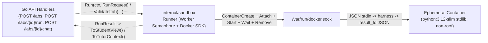

# Code Runner & Sandbox Design Specification

> **Status:** Finalized design specification (implemented on `feat/code-runner`)  
> **Repository:** https://github.com/kradmoned/seekhein  
> **Go Module:** `github.com/kradmoned/seekhein`  
> **Branch:** `feat/code-runner`  
> **Scope:** Go `internal/sandbox` package, containerized Python `unittest` harness, and Docker hardening contract  
> **Boundary:** Browser → Go API (`internal/sandbox`) → Docker Engine → Ephemeral Python Sandbox Container

---

## 1. Scope & Integration Boundary

The code runner is built as a **clean, self-contained internal Go package (`internal/sandbox`)** inside the main Go backend rather than forking `sounishnath003/code-execution-sandbox-engine-golang`. We adopt Docker container hardening patterns (no network, CPU/memory/PID caps, non-root user, read-only rootfs, forced teardown) while avoiding multi-language `stdin`/`stdout` boilerplate that does not fit Python `unittest` labs.



### Responsibilities

| Caller / Flow | Method Called | What `internal/sandbox` Returns |
|---|---|---|
| **Student Run** (`POST /api/labs/{id}/run`) | `Runner.Run(ctx, req)` → `result.ToStudentView()` | Safe `StudentRunResult`: status, score (`0..100`), `ran` / `total` / `passed` / `failed` counts, ordered per-test breakdown (`{index, name, display_name, status, passed, inputs, expected, actual, error_type, error_message, traceback, stdout}`), top-level `stdout`, and `solution.py` syntax-error line only |
| **AI Tutor** (`POST /api/labs/{id}/chat`) | `result.ToTutorContext()` (or persisted context from latest run) | `TutorRunContext`: overall progress (`score`, `ran`/`total`), `passed_tests`, **all** failing/timed-out tests with full `inputs`/`expected`/`actual`, per-test `stdout`, `solution.py` `traceback`, and internal `detail` (server-side only, passed to Python AI service + leak guard) |
| **Teacher Lab Upload** (`POST /api/labs`) | `Runner.ValidateLab(ctx, solutionCode, testCode)` | Rich `ValidationResult`: enforces `total >= 1` and 100% pass rate; returns syntax-error `source` (`"solution"` vs `"tests"`), full per-test diagnostics (including `<test_suite>` tracebacks), and pedagogical authoring `Warnings` |
| **Standalone Local Testing (Optional)** | `cmd/runner` thin HTTP wrapper | Exposes `GET /health`, `POST /run`, and `POST /validate` locally for independent runner testing |

---

## 2. Language & Test Format

- **Language:** Python 3.12 stdlib only (no third-party packages).
- **Module Contract:** Student code is written inside the container as `/work/solution.py`. Teacher-authored tests import student symbols using standard Python imports:
  - `from solution import two_sum, ...`
  - `import solution`
- **Strict `unittest.TestCase` Standard:**
  - Teachers write standard `unittest.TestCase` subclasses with `def test_*(self):` methods (top-level `def test_*()` functions are not discovered).
  - Full standard `unittest` lifecycle is supported: `setUpClass` / `tearDownClass`, `setUp` / `tearDown`, and `addCleanup` (`doCleanups()`).
  - **Automatic Boot.dev assertion & input capture (zero custom helpers):**
    - Equality assertions (`assertEqual`, `assertAlmostEqual`, `assertListEqual`, `assertDictEqual`, `assertSetEqual`, `assertTupleEqual`, `assertCountEqual`) are transparently intercepted by the harness to record `actual` and `expected` for both passing and failing tests.
    - Standard `with self.subTest(**params):` blocks capture `inputs` (`k=repr(v), ...`) and optional `msg` labels.
  - **`subTest` Scoring & Expansion:**
    - Methods without `subTest` (or with 1 `subTest`) produce **1** scored test entry.
    - Methods with `N > 1` `subTest` iterations expand into `N` individual scored entries (`test_name[1]` .. `test_name[N]`), giving students partial credit and per-case Boot.dev output even when an iteration fails or times out.
  - **Continue-on-failure (never fail-fast):** Every discovered method and `subTest` runs independently so the student always sees `ran` vs. `total` and the full per-test breakdown.
  - **Student-facing labels & server-side test protection:**
    - The first line of a method's docstring (or `subTest(msg=...)`) becomes `display_name`, falling back to humanizing the method name (`test_empty_list` → `"Empty list"`).
    - All test results show full Boot.dev diagnostics (`Inputs`, `Expecting`, `Actual`, `ErrorMessage`, `solution.py`-only `Traceback`, and per-test `Stdout`) to maximize student learning, while raw test source and reference solutions **never** leave the server.
  - Labs with **0 discovered `unittest.TestCase` test methods** are rejected at teacher upload time by `ValidateLab`.

---

## 3. Python Sandbox Docker Image

A dedicated `Dockerfile` builds the sandbox image (`seekkhein-python-sandbox:latest`):

- **Base image:** `python:3.12-slim` (pure Python 3.12 stdlib — zero `pip` installs)
- **Non-root user:** `sandbox` (`UID=1000`, `GID=1000`) baked into the image
- **Baked-in harness:** Read-only runner script (`/opt/sandbox/harness.py`, owned by `root:root`, mode `0555`) executed as container entrypoint (`python3 -B /opt/sandbox/harness.py` with `PYTHONDONTWRITEBYTECODE=1`)
- **Fail-fast startup check:** `NewRunner(ctx, cfg)` pings the Docker daemon (`Ping`) and verifies the configured sandbox image exists locally (`ImageInspect`), returning a clear, actionable error (`make sandbox-image`) on startup if Docker is unreachable or the image has not been built.

---

## 4. Docker Communication & Payload Delivery

Go communicates directly with the Docker Engine via the **Official Docker Go SDK** (`github.com/docker/docker/client`, initialized with `client.FromEnv` and `client.WithAPIVersionNegotiation()`) over `/var/run/docker.sock`.

- **Zero host bind mounts and zero host temp files:** Nothing is written to the host filesystem.
- **JSON-over-stdin streaming:**
  1. `ContainerCreate` configures `OpenStdin: true`, `StdinOnce: true`, `AttachStdin: true`, `AttachStdout: true`, `AttachStderr: true`, `Tty: false`, plus all `HostConfig` security/resource limits.
  2. `ContainerAttach` opens the hijacked stream (`Stdin: true, Stdout: true, Stderr: true, Stream: true`).
  3. `ContainerStart` starts the container.
  4. Go writes the JSON payload (`{"code": "...", "tests": "...", "per_test_timeout_sec": 2, "max_stdout_bytes": 16384, "max_test_stdout_bytes": 4096}`) to `attach.Conn` and immediately calls `attach.CloseWrite()` so the Python harness receives `EOF` on `sys.stdin`.
  5. Go demuxes the multiplexed Docker stream via `stdcopy.StdCopy` into mutex-guarded bounded buffers (`limitedBuffer`: 256KB stdout, 32KB stderr) so a misbehaving container cannot OOM the Go API process.
  6. Go awaits completion via `ContainerWait(ctx, id, WaitConditionNotRunning)` **after** `ContainerStart` (calling `WaitConditionNotRunning` on a newly `"created"` container returns immediately before execution), bounded by `ContainerTimeout` (`context.WithTimeout`).
  7. After exit or timeout, Go inspects the container (`ContainerInspect`) to check `State.OOMKilled` and `State.ExitCode`.
  8. `defer ContainerRemove(cleanupCtx, containerID, container.RemoveOptions{Force: true})` runs unconditionally (using a short independent cleanup context) so timed-out or failed containers are never leaked.

```mermaid
sequenceDiagram
    autonumber
    participant Go as Go Runner (internal/sandbox)
    participant Docker as Docker Engine (SDK)
    participant Py as Container Harness (UID 1000)

    Go->>Go: Validate input sizes (<= 64KB each)
    Go->>Go: Acquire worker semaphore (max 4, wait <= 10s)
    Go->>Docker: ContainerCreate (no net, ro rootfs, tmpfs /work & /tmp mode=1777, 128MB, 0.5 CPU, 64 PIDs)
    Go->>Docker: ContainerAttach (stdin/stdout/stderr)
    Go->>Docker: ContainerStart
    Go->>Py: Write JSON {code, tests, per_test_timeout_sec} + CloseWrite() (EOF)
    Go->>Docker: ContainerWait (WaitConditionNotRunning)
    Py->>Py: Save result_fd = os.dup(1); write /work/solution.py
    Py->>Py: compile(tests, "<test_suite>", "exec"); del test_src
    Py->>Py: Redirect FD 1 & FD 2 -> bounded _PipeCapture
    loop Each unittest.TestCase method / subTest (SIGALRM = 2s)
        Py->>Py: Run test lifecycle + assertEqual/subTest capture
    end
    Py->>Go: Write single JSON result to result_fd; os._exit(0)
    Docker-->>Go: ContainerWait returns (or hard 6s ctx deadline expires)
    Go->>Docker: ContainerInspect (check OOMKilled / ExitCode)
    Go->>Docker: ContainerRemove(Force: true)
    Go->>Go: Release worker semaphore & parse result
```

---

## 5. Test-Source Isolation & Output Capture

### In-Container Harness Lifecycle

1. **Read & close stdin:** Read the JSON payload from `sys.stdin` and immediately close stdin.
2. **Reserve output channel:** Duplicate the original stdout descriptor (`result_fd = os.dup(1)`) so the harness retains an exclusive channel back to Go that student code cannot accidentally corrupt.
3. **Materialize student code only:** Write `code` to `/work/solution.py` inside the ephemeral `tmpfs` mount (`/work`), and add `/work` to `sys.path`.
4. **In-memory test compilation (never on disk):** Compile `tests` in memory using `compile(test_src, "<test_suite>", "exec")` into a code object, then immediately run `del test_lines, test_src, raw_input, payload` before pre-compiling or importing `solution.py`. **No test file ever exists on disk.**
5. **Redirect FD 1 & FD 2 via `_PipeCapture`:**
   - Uses an `os.pipe()` drained by a daemon thread up to **4KB per test** and **16KB total** across the run, then redirects FD 1 & FD 2 to `/dev/null` on `stop()` so the reader thread hits deterministic `EOF`. Top-level prints during `import solution` are stored in `RunResult.Stdout`.
   - Because `result_fd` is a separate duped descriptor written only after all captures stop, student `print('{"status":"ok",...}')` statements **cannot forge or corrupt** the JSON result read by Go.
6. **Compile tests, import & execute under per-test timeout:**
   - Syntax errors in `<test_suite>` emit `status = "syntax_error"` with `source = "tests"`, `line`, and `code_line` (for teacher `ValidateLab`, stripped in `ToStudentView()`).
   - Syntax errors in `/work/solution.py` emit `status = "syntax_error"` with `source = "solution"`, `line`, and `code_line` (shown to student).
   - Import-time runtime exceptions emit `status = "runtime_error"` with full raw traceback in `internal_error`.
   - Discovered `unittest.TestCase` subclasses execute `setUpClass` → per-method (`setUp` → method / expanded `subTest`s → `tearDown` → `doCleanups`) → `tearDownClass` under per-test/per-subtest `signal.SIGALRM` timers (`2s`).
   - **Filtered `solution.py` traceback extraction:** Keeps **only** frames matching `/work/solution.py` (`{line, function, code}`), stripping all `<test_suite>` and harness frames from `traceback` while keeping the full raw traceback in server-side `detail`.
7. **Sanitize & emit JSON:** Write the single UTF-8 JSON object to `result_fd`, close `result_fd`, and exit via `os._exit(0)`.

### Threat Model Honesty (Hackathon Scope vs. Post-Hackathon)

- **Mitigated now:**
  - Disk exfiltration of test source (`open(...)`, `os.listdir`): test code is never written to disk and `test_src` is deleted before student code runs.
  - Network exfiltration (`requests`, `urllib`, `socket`): blocked by `NetworkMode: "none"`.
  - Host filesystem tampering / container escape: blocked by read-only rootfs, `CapDrop: ["ALL"]`, `no-new-privileges:true`, non-root UID 1000, and zero bind mounts.
  - Output stream / JSON injection: student stdout/stderr are isolated via `_PipeCapture` away from `result_fd` and size-capped.
  - Fork bombs / memory bombs / infinite loops: blocked by `PidsLimit: 64`, `128MB` RAM with swap off, `0.5` vCPU, `2s` per-test `SIGALRM`, and `6s` hard container removal.
- **Acknowledged out-of-scope for hackathon:**
  - Because tests and student code execute in the same Python interpreter process, adversarial introspection (`gc.get_objects()`, `sys._getframe()`, modifying `signal.SIGALRM`) is theoretically possible in-process.
  - **Post-hackathon upgrade path:** Run student code in a separate unprivileged worker subprocess communicating over a narrow RPC pipe (or gVisor / Firecracker microVM).

---

## 6. Resource Limits, Hardening & Concurrency

### Docker `HostConfig` & Container Security Settings

| Setting | Value | Purpose |
|---|---|---|
| `NetworkMode` | `"none"` | Disables all network interfaces |
| `Memory` | `128 * 1024 * 1024` (128 MiB) | Hard RAM cap |
| `MemorySwap` | `128 * 1024 * 1024` (equal to `Memory`) | Disables swap completely |
| `NanoCPUs` | `500_000_000` (0.5 vCPU) | Prevents CPU starvation |
| `PidsLimit` | `64` | Blocks fork bombs and process floods |
| `ReadonlyRootfs` | `true` | Prevents modifying system binaries, harness, or Python stdlib |
| `Tmpfs` | `{"/work": "rw,noexec,nosuid,size=8m,mode=1777", "/tmp": "rw,noexec,nosuid,size=4m,mode=1777"}` | World-writable sticky ephemeral `tmpfs` so UID `1000` can write `/work/solution.py` and `/tmp` under read-only rootfs |
| `CapDrop` | `["ALL"]` | Drops all Linux capabilities |
| `SecurityOpt` | `["no-new-privileges:true"]` | Blocks privilege escalation |
| `User` | `"1000:1000"` | Non-root `sandbox` user |
| `AutoRemove` | `false` (explicit `defer ContainerRemove Force: true`) | Ensures `ContainerInspect` can read `OOMKilled` before removal |

### Timeouts, Size Caps & Concurrency Controls

| Limit | Default | Enforcement Point |
|---|---|---|
| Max student `code` size | `64 KB` | Go `Runner.Run` before acquiring semaphore (`ErrCodeTooLarge`) |
| Max test suite size | `64 KB` | Go `Runner.Run` before acquiring semaphore (`ErrTestsTooLarge`) |
| Max concurrent containers | `4` (configurable) | Go bounded worker semaphore (`chan struct{}`) |
| Semaphore queue wait timeout | `10s` (configurable) | Go `select` on semaphore vs. timer/ctx (`ErrQueueFull`) |
| Per-test / per-subTest timeout | `2s` (configurable) | Python `SIGALRM` timer inside container |
| Hard container timeout | `6s` (configurable) | Go `context.WithTimeout` around start/wait + `ContainerRemove(Force: true)` |
| Max captured student stdout | `16 KB` total (`4 KB`/test) | Python `_PipeCapture` + Go `limitedBuffer` (`StdoutTruncated: true`) |

---

## 7. Go Interface Contract & Leak-Safe Views

Package: `internal/sandbox`

```go
package sandbox

import (
	"context"
	"errors"
	"time"
)

var (
	ErrCodeTooLarge       = errors.New("sandbox: code exceeds maximum size")
	ErrTestsTooLarge      = errors.New("sandbox: tests exceed maximum size")
	ErrQueueFull          = errors.New("sandbox: worker queue saturated")
	ErrSandboxUnavailable = errors.New("sandbox: docker daemon or image unavailable")
)

type Config struct {
	Image              string        // default: "seekkhein-python-sandbox:latest"
	MaxConcurrent      int           // default: 4
	QueueWaitTimeout   time.Duration // default: 10 * time.Second
	PerTestTimeout     time.Duration // default: 2 * time.Second
	ContainerTimeout   time.Duration // default: 6 * time.Second
	MaxCodeBytes       int           // default: 64 * 1024
	MaxTestsBytes      int           // default: 64 * 1024
	MaxStdoutBytes     int           // default: 16 * 1024
	MaxTestStdoutBytes int           // default: 4 * 1024
	MemoryLimitBytes   int64         // default: 128 * 1024 * 1024
	NanoCPUs           int64         // default: 500_000_000
	PidsLimit          int64         // default: 64
}

type Runner interface {
	Run(ctx context.Context, req RunRequest) (*RunResult, error)
	ValidateLab(ctx context.Context, solutionCode, testCode string) (*ValidationResult, error)
	Close() error
}

// NewRunner creates a Docker-backed Runner and fails fast if Docker Ping
// or sandbox image inspection fails.
func NewRunner(ctx context.Context, cfg Config) (Runner, error)

type RunRequest struct {
	Code           string
	Tests          string
	PerTestTimeout time.Duration // optional override; 0 uses Config.PerTestTimeout
}

type RunStatus string

const (
	StatusOK           RunStatus = "ok"
	StatusSyntaxError  RunStatus = "syntax_error"
	StatusRuntimeError RunStatus = "runtime_error"
	StatusTimeout      RunStatus = "timeout"
	StatusOOM          RunStatus = "oom"
	StatusInternalErr  RunStatus = "internal_error"
)

type SyntaxErrorInfo struct {
	Source       string `json:"-"`                       // internal-only: "solution" or "tests"
	ErrorType    string `json:"error_type"`              // e.g. "SyntaxError", "IndentationError"
	ErrorMessage string `json:"error_message,omitempty"` // e.g. "expected ':'"
	Line         int    `json:"line"`                    // 1-based line number in solution.py (0 if not from solution.py)
	CodeLine     string `json:"code_line,omitempty"`     // offending line text from solution.py
}

type TraceFrame struct {
	Line     int    `json:"line"`
	Function string `json:"function"`
	Code     string `json:"code"`
}

type TestStatus string

const (
	TestPassed   TestStatus = "passed"
	TestFailed   TestStatus = "failed"
	TestTimedOut TestStatus = "timeout"
	TestNotRun   TestStatus = "not_run"
)

type TestResult struct {
	Index           int          `json:"index"`        // 1-based test order
	Name            string       `json:"name"`         // method name (e.g. "test_empty_list" or "test_cases[1]")
	DisplayName     string       `json:"display_name"` // docstring first line, subTest msg, or humanized Name
	Status          TestStatus   `json:"status"`       // "passed", "failed", "timeout", "not_run"
	Passed          bool         `json:"passed"`
	Inputs          string       `json:"inputs,omitempty"`
	Expected        string       `json:"expected,omitempty"`
	Actual          string       `json:"actual,omitempty"`
	ErrorType       string       `json:"error_type,omitempty"`
	ErrorMessage    string       `json:"error_message,omitempty"`
	Traceback       []TraceFrame `json:"traceback,omitempty"` // strictly solution.py frames only
	Stdout          string       `json:"stdout,omitempty"`
	StdoutTruncated bool         `json:"stdout_truncated,omitempty"`
	DurationMs      int64        `json:"duration_ms"`
	Detail          string       `json:"-"` // internal-only raw traceback/assertion snippet; never serialized to student

	hasDocstring bool
}

type RunResult struct {
	Status          RunStatus        `json:"status"`
	Score           int              `json:"score"`  // 0..100 integer percentage
	Ran             int              `json:"ran"`    // number of tests actually executed
	Passed          int              `json:"passed"` // number of tests that passed
	Failed          int              `json:"failed"` // number of tests that ran and failed/timed out
	Total           int              `json:"total"`  // total discovered tests in the lab
	Stdout          string           `json:"stdout"` // top-level import stdout (if any)
	StdoutTruncated bool             `json:"stdout_truncated"`
	DurationMs      int64            `json:"duration_ms"`
	Tests           []TestResult     `json:"tests"`
	SyntaxError     *SyntaxErrorInfo `json:"syntax_error,omitempty"`
	InternalError   string           `json:"-"` // never exposed to student
}
```

### Views & Helper Methods

1. **`(*RunResult).ToStudentView() StudentRunResult`** — Browser-safe view preserving full Boot.dev learning diagnostics on every test while keeping `Detail`, `InternalError`, and non-solution syntax errors strictly off the browser response:

```go
type StudentTestResult struct {
	Index           int          `json:"index"`
	Name            string       `json:"name"`
	DisplayName     string       `json:"display_name"`
	Status          TestStatus   `json:"status"`
	Passed          bool         `json:"passed"`
	Inputs          string       `json:"inputs,omitempty"`
	Expected        string       `json:"expected,omitempty"`
	Actual          string       `json:"actual,omitempty"`
	ErrorType       string       `json:"error_type,omitempty"`
	ErrorMessage    string       `json:"error_message,omitempty"`
	Traceback       []TraceFrame `json:"traceback,omitempty"`
	Stdout          string       `json:"stdout,omitempty"`
	StdoutTruncated bool         `json:"stdout_truncated,omitempty"`
	DurationMs      int64        `json:"duration_ms"`
}

type StudentRunResult struct {
	Status          RunStatus           `json:"status"`
	Score           int                 `json:"score"`
	Ran             int                 `json:"ran"`
	Passed          int                 `json:"passed"`
	Failed          int                 `json:"failed"`
	Total           int                 `json:"total"`
	Stdout          string              `json:"stdout"`
	StdoutTruncated bool                `json:"stdout_truncated"`
	DurationMs      int64               `json:"duration_ms"`
	Tests           []StudentTestResult `json:"tests"`
	SyntaxError     *SyntaxErrorInfo    `json:"syntax_error,omitempty"`
}
```

#### Example `StudentRunResult` JSON Payload (4-Test Submission via `subTest` + method: 2 Passed, 2 Failed)

```json
{
  "status": "ok",
  "score": 50,
  "ran": 4,
  "passed": 2,
  "failed": 2,
  "total": 4,
  "stdout": "",
  "stdout_truncated": false,
  "duration_ms": 14,
  "tests": [
    {
      "index": 1,
      "name": "test_examples[1]",
      "display_name": "Finds matching pair in basic list",
      "status": "passed",
      "passed": true,
      "inputs": "nums=[2, 7, 11, 15], target=9",
      "expected": "[0, 1]",
      "actual": "[0, 1]",
      "stdout": "checking nums=[2, 7, 11, 15]\n",
      "duration_ms": 1
    },
    {
      "index": 2,
      "name": "test_examples[2]",
      "display_name": "Returns empty list on empty input",
      "status": "failed",
      "passed": false,
      "inputs": "nums=[], target=5",
      "error_type": "IndexError",
      "error_message": "list index out of range",
      "traceback": [
        {
          "line": 4,
          "function": "two_sum",
          "code": "first = nums[0]"
        }
      ],
      "stdout": "checking nums=[]\n",
      "duration_ms": 2
    },
    {
      "index": 3,
      "name": "test_examples[3]",
      "display_name": "Does not reuse the same index twice",
      "status": "failed",
      "passed": false,
      "inputs": "nums=[3, 3], target=6",
      "expected": "[0, 1]",
      "actual": "[0, 0]",
      "error_type": "AssertionError",
      "error_message": "Lists differ: [0, 0] != [0, 1]\n\nFirst differing element 1:\n0\n1\n\n- [0, 0]\n+ [0, 1]",
      "stdout": "checking nums=[3, 3]\n",
      "duration_ms": 1
    },
    {
      "index": 4,
      "name": "test_negative_numbers",
      "display_name": "Handles negative integers",
      "status": "passed",
      "passed": true,
      "inputs": "nums=[-3, 4, 3, 90], target=0",
      "expected": "[0, 2]",
      "actual": "[0, 2]",
      "stdout": "checking nums=[-3, 4, 3, 90]\n",
      "duration_ms": 1
    }
  ]
}
```

#### Boot.dev-Style Rendered Student Output (from `StudentRunResult`)

```text
Running 4 tests...
---------------------------------
Test 1/4: Finds matching pair in basic list
Inputs:    nums=[2, 7, 11, 15], target=9
Expecting: [0, 1]
Actual:    [0, 1]
Stdout:    checking nums=[2, 7, 11, 15]
Result:    Pass (1ms)
---------------------------------
Test 2/4: Returns empty list on empty input
Inputs:    nums=[], target=5
Stdout:    checking nums=[]
Error:     IndexError: list index out of range
Traceback (solution.py):
  line 4, in two_sum: first = nums[0]
Result:    Fail (2ms)
---------------------------------
Test 3/4: Does not reuse the same index twice
Inputs:    nums=[3, 3], target=6
Expecting: [0, 1]
Actual:    [0, 0]
Stdout:    checking nums=[3, 3]
Result:    Fail (1ms)
---------------------------------
Test 4/4: Handles negative integers
Inputs:    nums=[-3, 4, 3, 90], target=0
Expecting: [0, 2]
Actual:    [0, 2]
Stdout:    checking nums=[-3, 4, 3, 90]
Result:    Pass (1ms)
=================================
FAIL — 2 passed, 2 failed (4/4 tests ran) · Score: 50%
```

2. **`(*RunResult).ToTutorContext() TutorRunContext`** — Server-side rich summary passed to the Python AI tutor service (Step 6), including what already passed (`PassedTests`), **all** failing/timed-out tests with full `Detail` (raw `<test_suite>` + `solution.py` tracebacks), per-test `Stdout`, and `SyntaxError`:

```go
type TutorSyntaxError struct {
	Source       string `json:"source"` // "solution" or "tests"
	ErrorType    string `json:"error_type"`
	ErrorMessage string `json:"error_message,omitempty"`
	Line         int    `json:"line"`
	CodeLine     string `json:"code_line,omitempty"`
}

type TutorTestFailure struct {
	Index        int          `json:"index"`
	Name         string       `json:"name"`
	DisplayName  string       `json:"display_name"`
	Status       TestStatus   `json:"status"` // "failed" or "timeout"
	Inputs       string       `json:"inputs,omitempty"`
	Expected     string       `json:"expected,omitempty"`
	Actual       string       `json:"actual,omitempty"`
	ErrorType    string       `json:"error_type,omitempty"`
	ErrorMessage string       `json:"error_message,omitempty"`
	Traceback    []TraceFrame `json:"traceback,omitempty"`
	Stdout       string       `json:"stdout,omitempty"`
	Detail       string       `json:"detail,omitempty"`
	DurationMs   int64        `json:"duration_ms"`
}

type TutorRunContext struct {
	Status         RunStatus          `json:"status"`
	Score          int                `json:"score"`
	Ran            int                `json:"ran"`
	Passed         int                `json:"passed"`
	Failed         int                `json:"failed"`
	Total          int                `json:"total"`
	DurationMs     int64              `json:"duration_ms"`
	PassedTests    []string           `json:"passed_tests"`
	Failures       []TutorTestFailure `json:"failures"`
	SyntaxError    *TutorSyntaxError  `json:"syntax_error,omitempty"`
	TopLevelStdout string             `json:"top_level_stdout,omitempty"`
	InternalError  string             `json:"internal_error,omitempty"`
}
```

3. **`Runner.ValidateLab(ctx, solutionCode, testCode) (*ValidationResult, error)`** — Used when a teacher uploads a `.md` lab:
   - **Blocking validation gates:** Rejects labs (`Valid = false`) if `Status != StatusOK`, `TotalTests < 1` (`"lab must define at least 1 unittest.TestCase test method"`), or `PassedTests != TotalTests`.
   - **Full teacher diagnostics:** Includes syntax-error `Source` (`"solution"` vs. `"tests"`), full unredacted tracebacks (`FullTraceback`), `Inputs`/`Expected`/`Actual`, and per-test `Stdout`.
   - **Non-blocking pedagogical `Warnings`:**
     1. *Slow reference test:* warns if any test takes `> 50%` of `PerTestTimeout`.
     2. *Missing docstring label:* warns for test methods lacking a docstring `display_name` (deduplicated across expanded `subTest` entries).

```go
type TeacherSyntaxError struct {
	Source       string `json:"source"` // "solution" or "tests"
	ErrorType    string `json:"error_type"`
	ErrorMessage string `json:"error_message"`
	Line         int    `json:"line"`
	CodeLine     string `json:"code_line,omitempty"`
}

type TeacherTestDiagnostic struct {
	Index         int        `json:"index"`
	Name          string     `json:"name"`
	DisplayName   string     `json:"display_name"`
	Status        TestStatus `json:"status"`
	Passed        bool       `json:"passed"`
	Inputs        string     `json:"inputs,omitempty"`
	Expected      string     `json:"expected,omitempty"`
	Actual        string     `json:"actual,omitempty"`
	ErrorType     string     `json:"error_type,omitempty"`
	ErrorMessage  string     `json:"error_message,omitempty"`
	FullTraceback string     `json:"full_traceback,omitempty"`
	Stdout        string     `json:"stdout,omitempty"`
	DurationMs    int64      `json:"duration_ms"`
}

type ValidationResult struct {
	Valid       bool                    `json:"valid"`
	Summary     string                  `json:"summary"`
	Status      RunStatus               `json:"status"`
	DurationMs  int64                   `json:"duration_ms"`
	TotalTests  int                     `json:"total_tests"`
	RanTests    int                     `json:"ran_tests"`
	PassedTests int                     `json:"passed_tests"`
	FailedTests int                     `json:"failed_tests"`
	SyntaxError *TeacherSyntaxError     `json:"syntax_error,omitempty"`
	Stdout      string                  `json:"stdout,omitempty"`
	Tests       []TeacherTestDiagnostic `json:"tests"`
	Warnings    []string                `json:"warnings,omitempty"`
}
```

---

## 8. Edge Cases & Status Classification Matrix

| Scenario | `Status` | `Score` | Student-Visible Output | Internal / HTTP Mapping Notes |
|---|---|---|---|---|
| All tests pass | `ok` | `100` | `ran == total`, `passed == total`, `failed == 0`; `{status: "passed", passed: true}`, `inputs`/`expected`/`actual`, per-test `stdout` | `score = passed * 100 / total` |
| Partial pass / assertion or runtime failure | `ok` | `passed * 100 / total` | `ran == total`, `passed` & `failed` counts; full Boot.dev details (`inputs`, `expected`, `actual`, `error_type`, `error_message`, `solution.py`-only `traceback`, per-test `stdout`) | Continue-on-failure ensures all methods & `subTest`s run; `<test_suite>` frames stripped; `Detail` retained for tutor & teacher only |
| `SyntaxError` / `IndentationError` in `solution.py` | `syntax_error` | `0` | `ran: 0`, `passed: 0`, `failed: 0`, `syntax_error: {error_type, error_message, line, code_line}` from `solution.py` only | `Source: "tests"` errors suppressed in `ToStudentView()` |
| Import-time runtime error or missing symbol (`ImportError`, `NameError`) | `runtime_error` | `0` | `ran: 0`, `status: "runtime_error"`, top-level `stdout`, `tests: []` | Full traceback kept internal |
| Single test or `subTest` exceeds `2s` (`SIGALRM`) | `ok` | `passed * 100 / total` | `ran == total`; timed-out case shows `{status: "timeout", passed: false, error_type: "TimeoutError", error_message: "Test exceeded 2s time limit"}`; remaining cases still run | Allows partial credit & visibility when one case loops |
| Hard container timeout (`6s` elapsed) | `timeout` | `0` | `status: "timeout"`, `ran: 0`, `tests: []` | Container killed & force-removed immediately |
| Container exceeds `128MB` RAM (`OOMKilled == true` or exit `137`) | `oom` | `0` | `status: "oom"`, `ran: 0`, `tests: []` | Detected via `ContainerInspect` `State.OOMKilled` |
| Fork bomb (`PidsLimit: 64` hit) | `runtime_error` or `timeout` | `0` | No host impact; `status` reported cleanly | Container force-removed |
| Student stdout > `16KB` total (`4KB`/test) or fake JSON print | `ok` / `timeout` | Normal / `0` | Truncated stdout + `stdout_truncated: true` | `result_fd` remains uncorrupted |
| Student `code` or `tests` > `64KB` | Go `error` | — | HTTP `413 Payload Too Large` | `ErrCodeTooLarge` / `ErrTestsTooLarge` returned before semaphore wait |
| Worker pool saturated > `10s` | Go `error` | — | HTTP `429 Too Many Requests` | `ErrQueueFull` |
| Docker daemon down or image missing | Go `error` | — | HTTP `503 Service Unavailable` | `ErrSandboxUnavailable` (also caught fail-fast in `NewRunner`) |
| Teacher uploads lab with 0 `unittest.TestCase` test methods | `ValidateLab` fails | — | HTTP `422 Unprocessable Entity` | `ValidationResult.Valid == false` (`"lab must define at least 1 unittest.TestCase test method"`) |

---

## 9. Repository Layout & Test Strategy

### Implemented Repository Layout

```text
seekhein/
├── go.mod                           # module github.com/kradmoned/seekhein
├── go.sum
├── Makefile                         # sandbox-image, test, build, vet, runner
├── .gitignore
├── docs/
│   └── code-runner-spec.md          # This design specification
├── docker/
│   └── python-sandbox/
│       ├── Dockerfile               # python:3.12-slim stdlib + non-root user + harness
│       └── harness.py               # In-memory unittest.TestCase loader, FD-isolated JSON emitter
├── internal/
│   └── sandbox/
│       ├── config.go                # Config defaults & validation
│       ├── docker_client.go         # dockerAPI interface & Docker Go SDK wrapper
│       ├── errors.go                # Sentinel errors
│       ├── types.go                 # RunRequest, RunResult, StudentRunResult, TutorRunContext, ValidationResult
│       ├── runner.go                # Docker SDK Runner, worker semaphore, ContainerCreate/Attach/Start/Wait/Remove
│       └── runner_test.go           # Unit tests, Python harness wire tests, Docker integration tests
└── cmd/
    └── runner/                      # Optional thin standalone HTTP server for local testing
        ├── main.go
        └── main_test.go
```

> **Branch ownership (`feat/code-runner`):** Owns `docs/code-runner-spec.md`, `docker/python-sandbox/`, `internal/sandbox/`, and `cmd/runner/` so work merges cleanly with teammates' branches (`feat/api`, `feat/ai-tutor`, `feat/web`) without file conflicts.

### Verification & Test Coverage

1. **Unit tests (mocked `dockerAPI`):** `NewRunner` fail-fast checks, `HostConfig` hardening (`tmpfs` `mode=1777`, `NetworkMode: "none"`, `CapDrop`, `no-new-privileges`), `ContainerStart` before `ContainerWait` sequencing, `stdcopy` demuxing, OOM/timeout forced container removal, size checks before semaphore, `ErrQueueFull` saturation, and `ValidateLab` warnings (deduplicated across `subTest`s) + 0-test rejection.
2. **End-to-end Python `harness.py` wire tests:**
   - Standard `unittest.TestCase` assertions (`assertEqual`, `assertAlmostEqual`, `assertDictEqual`, `assertRaises`) and lifecycle (`setUpClass`, `tearDownClass`, `setUp`, `tearDown`, `addCleanup`).
   - `self.subTest(...)` single-case preservation and multi-case expansion (partial credit, per-case `Inputs`/`Expecting`/`Actual`/`Stdout`, filtered `solution.py`-only tracebacks, and per-subtest `SIGALRM` timeout continuing to remaining cases).
   - Bare top-level `def test_*()` functions ignored (`Total: 0`).
   - `setUpClass` failure failing class methods cleanly.
   - Syntax error `Source: "solution"` vs. `"tests"`, import error, stdout flood + JSON injection resistance, and test code never written to disk.
3. **HTTP wrapper tests (`cmd/runner/main_test.go`):** `/health`, `/run` (`student` vs. `tutor` views and `413`/`429`/`503` error mappings), and `/validate` (`200` vs. `422`).
4. **Real Docker integration tests (`TestDockerIntegration_ExecutionAndHardening`):** Stdlib `unittest` execution, OOM bomb (`StatusOOM`), network isolation (`NetworkMode: "none"`), and read-only rootfs enforcement.
